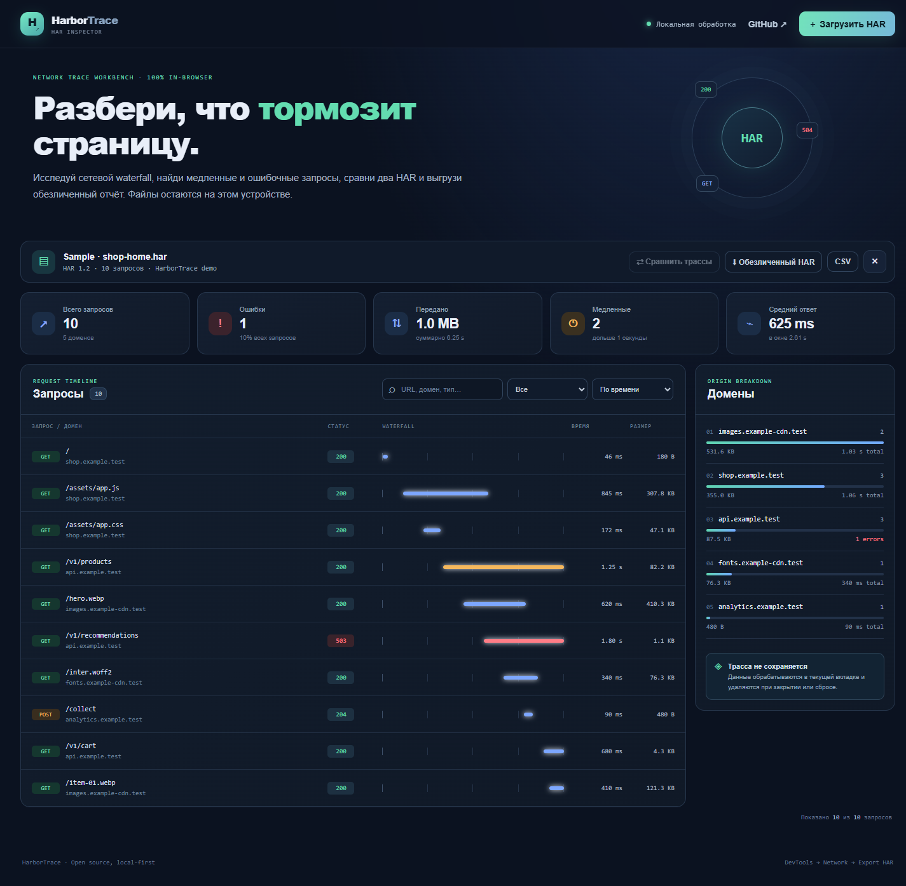

# HarborTrace

**Local-first HAR inspector for web performance and network debugging.** Import browser HAR files, inspect request timing and payload size, compare two captures, and export a scrubbed copy. No account, backend, analytics, or external font/image requests.

**Demo:** https://ghostnever-lkm.github.io/harbortrace/ · **Source:** https://github.com/GhosTnever-lkm/harbortrace · **License:** MIT



## Use it

1. In Chrome, Edge, or Firefox DevTools, open **Network** and export a HAR capture.
2. Open HarborTrace and drop the `.har` file onto the page or choose it from the file picker.
3. Search by URL, domain, method, or MIME type. Filter failed/slow/successful requests and sort by duration or transfer size.
4. Import another HAR to compare the last two captures. The comparison groups requests by method, host, and path and highlights latency changes of at least 20% and increased error counts.
5. Export CSV for the currently filtered request list, or download **Obfuscated HAR** before sharing.

Use **Open example** to explore the interface without a capture.

## What the scrubbed export removes

- Query parameters whose names look like tokens, API keys, secrets, passwords, session IDs, authorization values, or signatures.
- Username and password credentials embedded in request or redirect URLs.
- Authorization, proxy-authorization, cookie, set-cookie, and API-key headers; cookie arrays.
- Request body text and response body text.

The redaction is a convenience, not a guarantee that a capture contains no personal or confidential information. Review the exported file before sharing it. HAR exports can contain URLs, headers and identifiers that are not covered by generic patterns.

## Privacy and limits

Files are parsed in this browser tab and are not uploaded. Captures are held in memory only; closing or clearing the tab removes them. The local UI supports files up to 100 MB and at most 200,000 entries per capture. HAR is JSON, so very large files can temporarily use several times their file size in memory. Up to 2,500 matching requests are rendered at once; filtering narrows larger lists. Endpoint comparison ignores query strings and groups repeated URLs together. Timing values depend on the browser and capture environment; compare captures taken under similar conditions.

## Run locally

Use Node.js 20+ for the core checks:

```sh
npm run check
```

For the browser UI, serve this folder over HTTP (ES modules do not load consistently from `file://`) and open the local server URL.

## Development

```sh
npm test
```

HarborTrace uses plain browser JavaScript and Node's built-in test runner; it has no runtime dependencies.
